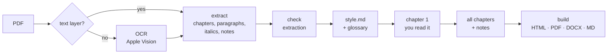

# book-translation

**English** · [简体中文](README.zh-CN.md)

A [Claude Code](https://claude.com/claude-code) skill that translates a whole English book — a PDF of several hundred pages, scanned or with a text layer — into a Simplified Chinese edition, with the notes linked and the names consistent from the first chapter to the last.

You give Claude the PDF. It reads the book's layout, writes a short description of the book and how it should sound in Chinese, fixes the Chinese for every recurring name, translates one chapter for you to read, then the rest, and builds the edition as HTML, PDF, Word and Markdown. With DeepSeek's cheapest model a 200,000-word book costs about **US $1** in API fees.

<p align="center">
  
</p>

## Contents

- [What you get](#what-you-get)
- [How it works](#how-it-works)
- [Install](#install)
- [Use](#use)
- [Cost and time](#cost-and-time)
- [Limitations](#limitations)
- [Running the scripts without Claude](#running-the-scripts-without-claude)
- [Configuration](#configuration)
- [Repository layout](#repository-layout)

## What you get

For each book, in `out/`:

| File | What it is |
|---|---|
| `<book>.zh.html` | One self-contained page: table of contents, reading typography, notes linked both ways, light and dark themes, readable on a phone, prints cleanly |
| `<book>.zh.pdf` | Printed from the HTML, with a PDF outline and clickable notes |
| `<book>.zh.docx` | Word document with real footnotes and heading styles (navigation pane works) |
| `<book>.zh.md` | Markdown with pandoc footnotes |

A complete example — source PDF, the config and style notes Claude wrote, the glossary, and all four outputs — is in [`examples/lamplighter`](examples/lamplighter).

<p align="center">
  
  
</p>

## How it works



Book-length translation goes wrong in a few predictable ways. Each stage is there to prevent one of them:

| What goes wrong | What prevents it |
|---|---|
| A name is translated three different ways across 150 chapters translated in parallel | A **glossary** is built from the whole book before translation starts and sent with every chunk. You can edit it; a later volume inherits it |
| Every book comes out sounding the same | **`style.md`**: a description of this particular book — genre, register, who narrates, naming tradition, what italics mean — with a worked example made from real paragraphs, inserted into every prompt |
| The model silently drops a sentence or a note marker in a long paragraph | Every chunk is **checked**: paragraph count, every `[^n]` marker, Chinese length against English length. A failing chunk is retried with the problem named, then paragraph by paragraph; anything still wrong is listed in `problems.txt` |
| The PDF's structure is misread: running heads glued into paragraphs, footnotes inside the text, a heading missed | **`inspect_pdf.py`** reads the type sizes and running heads before the config is written; **`check.py`** measures the extraction (paragraphs broken mid-sentence, unresolved notes, text lost at page edges) before any money is spent |
| Money spent on a whole book before anyone has read a page | **One chapter first**, read by you, then the rest. Every run is resumable; finished chunks are never paid for twice |

An optional second pass (`--review`) sends each chunk and its draft to an editor prompt that looks for omissions, mistranslations, glossary slips and translationese, and changes as little as possible.

## Install

Requirements: Claude Code, Python 3.9+, an API key for DeepSeek or Anthropic. Scanned PDFs additionally need macOS (OCR uses Apple Vision through [`ocrmac`](https://github.com/straussmaximilian/ocrmac), locally and for free).

```bash
git clone https://github.com/xubing0602/book-translation-skill.git
mkdir -p ~/.claude/skills
ln -s "$PWD/book-translation-skill/book-translation" ~/.claude/skills/book-translation
pip install -r book-translation-skill/book-translation/scripts/requirements.txt

# optional: PDF and Word output
python -m playwright install chromium
brew install pandoc          # or apt install pandoc / choco install pandoc
```

To make the skill available in one project only, put it in that project's `.claude/skills/` instead. Without Playwright or pandoc the PDF and Word files are skipped; HTML and Markdown are always built.

## Use

Open Claude Code in an empty folder and ask:

> Translate `~/Downloads/middlemarch.pdf` into Chinese.

> 帮我把这本扫描版的书翻成中文：`~/books/history-of-tea.pdf`

Claude sets up the project, then asks you to paste your API key into `.env` (it never handles the key itself). It stops for you three times, because these choices are yours and cheap to change early:

1. **`style.md`** — what the book is and how it should read in Chinese: register, a reference translation to aim for, naming tradition, the Chinese title.
2. **The glossary** — the Chinese for every recurring name and term. Edit `books/<book>/glossary.json` directly.
3. **Chapter 1** — read it side by side with the English. Then the rest of the book runs (1–3 hours for a long book; it reports progress and an ETA).

At the end it builds the edition, runs the final checks, and tells you what is left in `problems.txt`, if anything.

Other things you can ask: add the next volume of a series (it inherits the first volume's settings and glossary), re-translate one chapter, run the review pass, rebuild the outputs, or check an existing translation for dropped notes.

## Cost and time

Estimates for a 200,000-word book (about 600 pages), translation of body text and notes:

| Model | API cost | Notes |
|---|---|---|
| DeepSeek `deepseek-flash` | about $1 | the template's setting; half price 16:30–00:30 UTC |
| DeepSeek `deepseek-v4-pro` | about $3 | |
| Claude Opus | $15 or more | more with thinking at high effort |
| any of the above with `--review` | about ×2 | |

Prices are per-token list prices at the time of writing; `translate.py --dry-run` prints an estimate for your book before anything is sent, and the running cost is printed as it goes. A full run takes about one to three hours with the default three chapters in parallel. OCR is free and local, at a few seconds per page.

## Limitations

- **English to Simplified Chinese only.** The prompts are written for Chinese (punctuation, translationese, naming traditions).
- **Scanned PDFs need macOS.** On Linux or Windows, PDFs with a text layer work fully.
- **Latin-script sources.** A scan printed in another script (Devanagari, Greek) cannot be OCR'd; a scan that mixes one in can be filtered (`min_wordlike`).
- **Footnotes at the foot of the page in a text PDF** are not separated by the text extractor (endnotes are). Treating the book as a scan handles them.
- **Layouts vary.** The config has a key for each layout problem met so far (two columns, notes restarting on every page, chapters ending in a colophon instead of starting with a heading), but a new book can still need one more. `check.py` tells you when the extraction is off.
- **Read the result.** The checks catch missing sentences and notes, not every mistranslation. Chapter 1 is read before the full run for this reason.

## Running the scripts without Claude

The pipeline is plain Python; Claude's part is writing `config.json` and `style.md`, judging the checks, and fixing what they find. You can do that yourself. From a project folder:

```bash
S=~/.claude/skills/book-translation/scripts
python $S/inspect_pdf.py pdf/book.pdf                 # text or scan? type sizes, running heads
python $S/ocr.py --book book                          # scans only
python $S/extract.py --book book && python $S/check.py --book book
python $S/glossary.py --book book                     # then edit books/book/glossary.json
python $S/translate.py --book book --chapters 1       # read it
python $S/translate.py --book book                    # the rest; --notes for the notes
python $S/build.py --book book
python $S/check.py --book book --output
```

Every script lists all its arguments at the top of the file and in `--help`. The config keys are documented in [`references/config-text.md`](book-translation/references/config-text.md) and [`references/config-scan.md`](book-translation/references/config-scan.md); how to write `style.md` in [`references/style-guide.md`](book-translation/references/style-guide.md).

## Configuration

`.env` in the project folder (template: [`assets/env.example`](book-translation/assets/env.example)):

| Variable | Default | Meaning |
|---|---|---|
| `PROVIDER` | `anthropic` | `openai` for any OpenAI-compatible API (DeepSeek), or `anthropic` |
| `API_KEY` | | your key |
| `BASE_URL` | | `https://api.deepseek.com` for DeepSeek |
| `MODEL` | `claude-opus-5` | e.g. `deepseek-flash`, `deepseek-v4-pro` |
| `THINKING` | `on` | `off` turns off thinking (cheaper, faster) |
| `CONCURRENCY` | `3` | chapters translated in parallel |
| `CHUNK_WORDS` | `1200` | English words per request; lower it if responses are cut off |

Per-book files live in `books/<book>/`: `config.json` (how to read the PDF), `style.md` (how to translate it), `glossary.json` (names and terms). A book can override any of the three shipped prompts with its own `system.md`, `glossary.md` or `review.md`.

## Repository layout

```
book-translation/            the skill — this folder is what goes in ~/.claude/skills/
  SKILL.md                   the workflow Claude follows
  scripts/                   the pipeline (inspect, ocr, extract, check, glossary, translate, build)
  prompts/                   translation, glossary and review prompts
  references/                config keys for text and scanned PDFs, how to write style.md,
                             a worked convention set for Indian classics (genres/)
  assets/env.example
examples/
  lamplighter/               a finished example: PDF, config, style.md, glossary, outputs
  ferryman_scan.pdf          a short scanned test book with footnotes
  make_samples.py            regenerates both sample PDFs (their text is original)
docs/                        screenshots
```

## License

[MIT](LICENSE)
