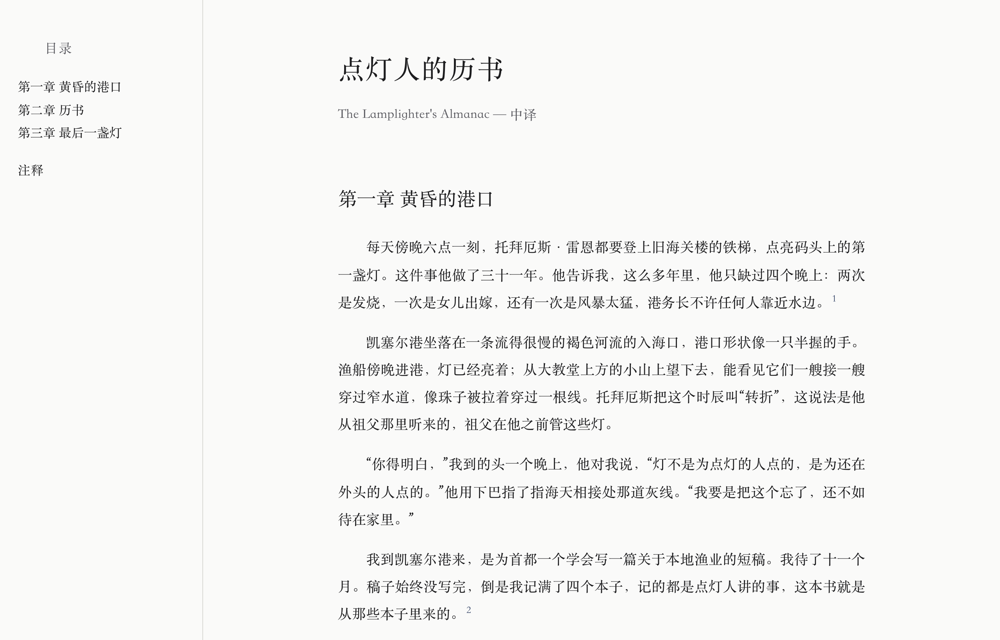
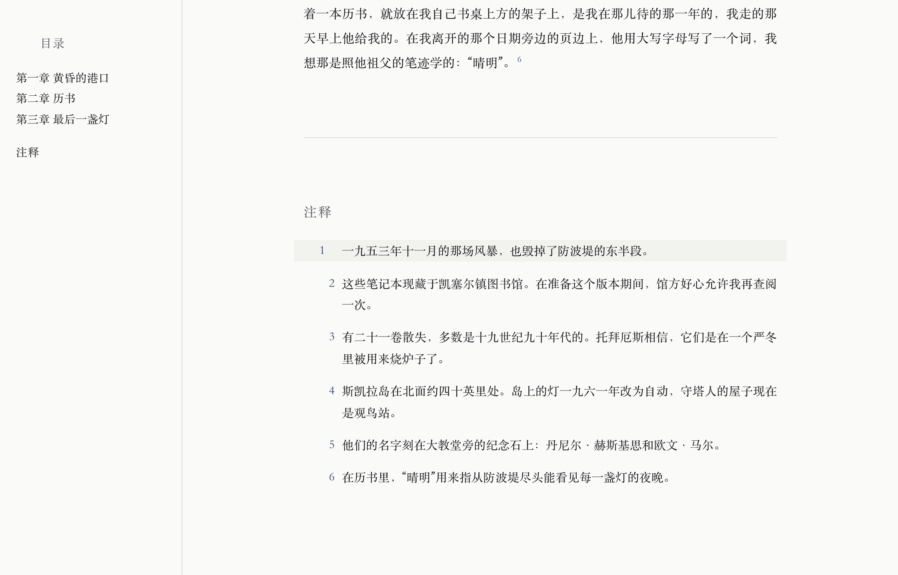
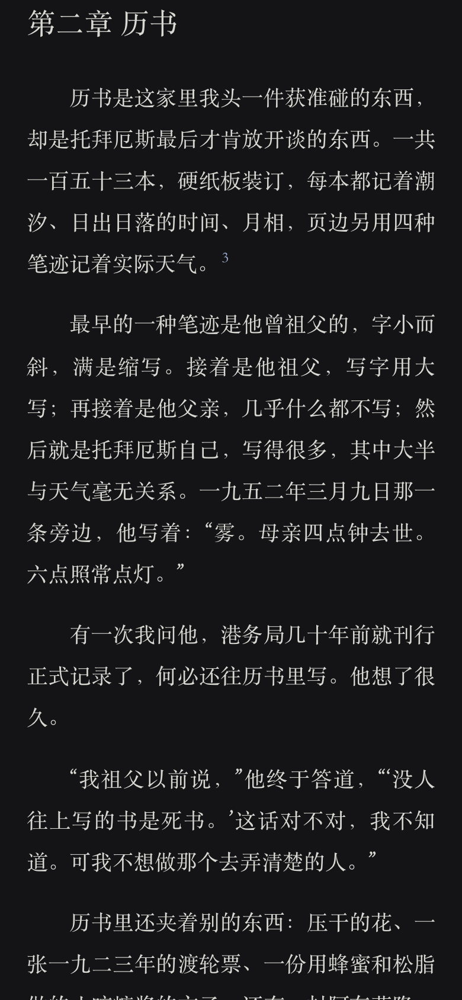
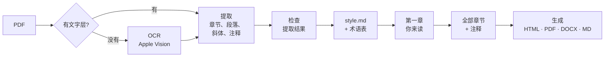

# scriptorium

[English](README.md) · **简体中文**

*Scriptorium：中世纪修道院里抄写书籍的缮写室。*

`translate-book-zh` 是一个 [Claude Code](https://claude.com/claude-code) 技能（skill），把整本英文书——几百页的 PDF，扫描版或带文字层的都可以——译成读来像正式出版译本的高质量简体中文版，API 费用约 **1 美元**。

- **质量。** 每本书都有自己的风格说明——体裁、语域、参照的译本、译名传统——附一段用本书真实段落做的示范，随每次请求发出。提示词专门针对翻译腔。
- **便宜。** 用 DeepSeek 最便宜的模型，一本 20 万词的书约 1 美元。先译一章给你读，全书开译前先估算费用，已完成的部分不会重复付费。
- **前后一致。** 开译之前，所有反复出现的人名和术语先在术语表里定下来，第 150 章和第 1 章用的是同一个译名。续卷直接继承。
- **不漏句、不漏注。** 每一段都检查是否缺段落、缺注码、中文比英文短得不正常，不合格就重译，先整段、再逐段；仍有问题的列出来给你看。
- **审校。** 可选的第二遍把每段初稿连同英文交给一个编辑提示词，修正漏译、误译和术语不一致，改动尽量少。
- **整本书。** 扫描件在本地 OCR；章节、斜体、注释都保留，注释保持链接。产出 HTML、PDF、Word 和 Markdown。

把 PDF 交给 Claude 即可。它会读懂版式，写好风格说明和术语表交你确认，先译第一章给你读，再译完全书。

<p align="center">
  
</p>

## 目录

- [产出什么](#产出什么)
- [怎么做的](#怎么做的)
- [安装](#安装)
- [使用](#使用)
- [费用和时间](#费用和时间)
- [局限](#局限)
- [不用 Claude，直接跑脚本](#不用-claude直接跑脚本)
- [配置](#配置)
- [仓库结构](#仓库结构)

## 产出什么

每本书在 `out/` 下生成：

| 文件 | 内容 |
|---|---|
| `<书名>.zh.html` | 单个网页：目录、适合阅读的排版、正文与注释双向链接、浅色和深色主题、手机可读、可直接打印 |
| `<书名>.zh.pdf` | 由 HTML 打印而成，带书签目录和可点击的注释 |
| `<书名>.zh.docx` | Word 文档，注释是真正的脚注，标题用标题样式（导航窗格可用） |
| `<书名>.zh.md` | Markdown，pandoc 脚注格式 |

完整示例——原书 PDF、Claude 写的配置和风格说明、术语表、四种产出——在 [`examples/lamplighter`](examples/lamplighter)。

<p align="center">
  
  
</p>

## 怎么做的



整本书的翻译，出错的方式就那么几种。每一步都是为了堵住其中一种：

| 容易出的问题 | 怎么防 |
|---|---|
| 150 章并行翻译，同一个名字出现三种译法 | 翻译前先从全书生成**术语表**，随每一段一起发给模型。你可以改它；续卷直接继承 |
| 什么书译出来都是一个腔调 | **`style.md`**：针对这一本书的说明——体裁、语域、叙述者、译名传统、斜体的含义——附一段用真实段落做的示范，嵌进每一个提示词 |
| 长段落里模型悄悄漏掉一句话或一个注码 | 每一段都**校验**：段落数、每个 `[^n]` 注码、中文长度与英文长度之比。不合格的整段重译并点明问题，仍不合格的逐段重译；最后还有问题的列进 `problems.txt` |
| PDF 结构读错：页眉混进正文、脚注混进正文、漏掉标题 | 写配置前，**`inspect_pdf.py`** 先读出字号和页眉；花钱之前，**`check.py`** 先量化提取结果（段落断在句中、注释对不上、扫描页边丢字） |
| 没人读过一页，钱已经花在整本书上 | **先译第一章**，你读过之后再译其余部分。所有运行都可续跑，已完成的部分不会重复付费 |

可选的第二遍（`--review`）把每一段连同初稿交给一个编辑提示词，查漏译、误译、术语不一致和翻译腔，改动尽量少。

## 安装

需要：Claude Code、Python 3.9+、DeepSeek 或 Anthropic 的 API key。扫描版 PDF 还需要 macOS（OCR 通过 [`ocrmac`](https://github.com/straussmaximilian/ocrmac) 调用 Apple Vision，本地运行，免费）。

```bash
git clone https://github.com/xubing0602/scriptorium.git
mkdir -p ~/.claude/skills
ln -s "$PWD/scriptorium/translate-book-zh" ~/.claude/skills/translate-book-zh
pip install -r scriptorium/translate-book-zh/scripts/requirements.txt

# 可选：PDF 和 Word 输出
python -m playwright install chromium
brew install pandoc          # 或 apt install pandoc / choco install pandoc
```

只想在某个项目里用，就放进那个项目的 `.claude/skills/`。没装 Playwright 或 pandoc 时只是跳过 PDF 和 Word，HTML 和 Markdown 总会生成。

## 使用

在一个空文件夹里打开 Claude Code，输入 `/translate-book-zh`，或者直接说：

> 帮我把这本扫描版的书翻成中文：`~/books/history-of-tea.pdf`

> Translate `~/Downloads/middlemarch.pdf` into Chinese.

Claude 会建好项目，请你把 API key 粘贴进 `.env`（它自己不碰 key）。中途会停下来等你三次，因为这些决定是你的，而且越早改越便宜：

1. **`style.md`**——这本书是什么、中文该怎么读：语域、可以参照的译本、译名传统、中文书名。
2. **术语表**——每个反复出现的人名和术语的中文。直接改 `books/<书>/glossary.json`。
3. **第一章**——和英文对照着读。之后译完全书（长书约一到三小时，会显示进度和预计剩余时间）。

最后它生成成品、跑最终检查，告诉你 `problems.txt` 里还剩什么（如果有的话）。

还可以让它：加一本续卷（继承第一卷的配置和术语表）、重译某一章、跑审校、重新生成成品、检查已有译本有没有丢注码。

## 费用和时间

以一本 20 万词（约 600 页）的书估算，含正文和注释：

| 模型 | API 费用 | 说明 |
|---|---|---|
| DeepSeek `deepseek-flash` | 约 1 美元 | 模板默认；北京时间 00:30–08:30 半价 |
| DeepSeek `deepseek-v4-pro` | 约 3 美元 | |
| Claude Opus | 15 美元以上 | 开高强度思考会更多 |
| 以上任一加 `--review` | 约 ×2 | |

价格按撰写时的官方单价计算；`translate.py --dry-run` 会在发送任何请求之前给出这本书的估算，运行时也会实时显示已花费用。默认三章并行，整本书约一到三小时。OCR 在本地免费运行，每页几秒。

## 局限

- **只做英译简体中文。** 提示词是针对中文写的（标点、翻译腔、译名传统）。
- **扫描版需要 macOS。** 在 Linux 或 Windows 上，带文字层的 PDF 完全可用。
- **拉丁字母原书。** 用其他文字（天城体、希腊文）印的扫描件无法 OCR；夹杂其他文字的可以过滤掉（`min_wordlike`）。
- **带文字层的 PDF 里的页脚注**，文字层提取器分不出来（尾注可以）。把书当作扫描件处理即可。
- **版式千差万别。** 目前遇到过的版式问题（双栏、每页重新编号的脚注、章末题记而非章首标题）都有对应的配置项，但新书仍可能需要再加一个。提取不对时 `check.py` 会告诉你。
- **成品要读。** 检查能发现漏句漏注，发现不了每一处误译。所以全书开译前先读第一章。

## 不用 Claude，直接跑脚本

流水线是普通的 Python；Claude 负责的是写 `config.json` 和 `style.md`、判断检查结果、修正发现的问题。这些你也可以自己做。在项目文件夹里：

```bash
S=~/.claude/skills/translate-book-zh/scripts
python $S/inspect_pdf.py pdf/book.pdf                 # 文字版还是扫描版？字号、页眉
python $S/ocr.py --book book                          # 仅扫描版
python $S/extract.py --book book && python $S/check.py --book book
python $S/glossary.py --book book                     # 然后改 books/book/glossary.json
python $S/translate.py --book book --chapters 1       # 读一读
python $S/translate.py --book book                    # 其余章节；--notes 译注释
python $S/build.py --book book
python $S/check.py --book book --output
```

每个脚本的全部参数都写在文件开头，也可以 `--help` 查看。配置项见 [`references/config-text.md`](translate-book-zh/references/config-text.md) 和 [`references/config-scan.md`](translate-book-zh/references/config-scan.md)；`style.md` 的写法见 [`references/style-guide.md`](translate-book-zh/references/style-guide.md)。

## 配置

项目文件夹里的 `.env`（模板：[`assets/env.example`](translate-book-zh/assets/env.example)）：

| 变量 | 默认值 | 含义 |
|---|---|---|
| `PROVIDER` | `anthropic` | `openai` 表示任何 OpenAI 兼容接口（DeepSeek），或 `anthropic` |
| `API_KEY` | | 你的 key |
| `BASE_URL` | | DeepSeek 填 `https://api.deepseek.com` |
| `MODEL` | `claude-opus-5` | 例如 `deepseek-flash`、`deepseek-v4-pro` |
| `THINKING` | `on` | `off` 关闭思考（更便宜、更快） |
| `CONCURRENCY` | `3` | 并行翻译的章数 |
| `CHUNK_WORDS` | `1200` | 每次请求的英文词数；回复被截断时调低 |

每本书的文件在 `books/<书>/`：`config.json`（怎么读 PDF）、`style.md`（怎么译）、`glossary.json`（人名和术语）。一本书可以用自己的 `system.md`、`glossary.md` 或 `review.md` 覆盖自带的三个提示词。

## 仓库结构

```
translate-book-zh/           技能本体——放进 ~/.claude/skills/ 的就是这个文件夹
  SKILL.md                   Claude 遵循的工作流程
  scripts/                   流水线（inspect、ocr、extract、check、glossary、translate、build）
  prompts/                   翻译、术语表、审校提示词
  references/                文字版和扫描版 PDF 的配置项、style.md 写法、
                             印度古典文献的一套完整译名与文体约定（genres/）
  assets/env.example
examples/
  lamplighter/               完整示例：PDF、配置、style.md、术语表、成品
  ferryman_scan.pdf          一本带脚注的扫描版小样书
  make_samples.py            重新生成两份样书 PDF（文本为原创）
docs/                        截图
```

## 许可

[MIT](LICENSE)
